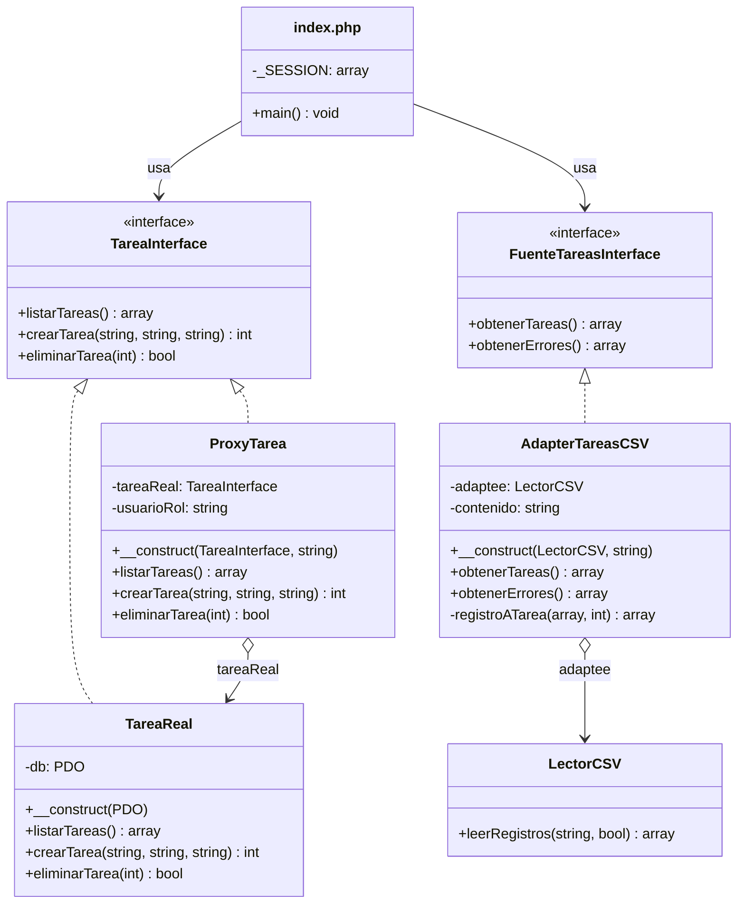

# CLAUDE.md — Sistema web de gestión de tareas (Parcial de Patrones de Diseño)

## 1. Rol

Actúas como **arquitecto de software senior** que además escribe el código. Tu prioridad es que el proyecto sea **simple, correcto y fácil de explicar en un examen**. Cada decisión debe poder justificarse en una frase. Si dudas entre una solución elegante y una simple, elige la simple.

## 2. Objetivo

Sistema web de gestión de tareas que funciona con base de datos real y demuestra dos patrones GoF estructurales:

| # | Caso de uso | Patrón |
|---|-------------|--------|
| CU1 | Eliminar tarea (solo administradores) | **Proxy** de protección |
| CU2 | Importar tareas desde un archivo CSV | **Adapter** |

### Reglas del curso (obligatorias)
- Solo patrones **GoF**. **Prohibidos: Singleton, Decorator y Facade.**
- 1 patrón por caso de uso. No agregues más patrones.

### Fuera del alcance
Registro de usuarios, editar/asignar tareas, fechas, búsqueda, notificaciones, APIs externas, frameworks, Composer, ORMs, Docker.

## 3. Problemática que resuelve cada patrón

> Redactadas al estilo del caso de referencia del banco que Javier usó como modelo. Ese ejemplo es una **guía de cómo presentar** el problema y la solución, no un diseño a copiar: allí el Adaptee era una base de datos antigua (`LegacyMainframeDB`); aquí el Adaptee **no es antiguo**, es simplemente una clase existente cuya interfaz no coincide con la que espera el sistema. Lo que define al Adaptee en el patrón genérico es la **incompatibilidad de interfaz**, no la antigüedad.

### CU1 — Proxy de protección
La aplicación permite a cualquier usuario autenticado listar y crear tareas. Eliminar, en cambio, es una operación destructiva e irreversible que solo deben ejecutar los administradores. La clase `TareaReal` ya resuelve correctamente el acceso a PostgreSQL y no conviene mezclarle reglas de seguridad: cada vez que cambie una regla de permisos habría que tocar la lógica de datos, con riesgo de romperla. Tampoco basta con ocultar el botón en la vista, porque cualquiera puede enviar la petición directamente.

**Solución:** `ProxyTarea` implementa la misma `TareaInterface` que `TareaReal`. `index.php` solo conoce la interfaz, así que no sabe si habla con el proxy o con el objeto real. El proxy deja pasar `listarTareas()` y `crearTarea()`, y en `eliminarTarea()` verifica que `usuarioRol` sea `admin` antes de delegar; si no lo es, responde 403 y `TareaReal` nunca se ejecuta.

### CU2 — Adapter
El sistema trabaja con tareas validadas (`titulo`, `descripcion`, `estado`), pero las tareas que se quieren cargar vienen en archivos CSV, y el componente que los lee (`LectorCSV`) solo entrega **filas de texto por posición** (`string[][]`) mediante `leerRegistros(contenido, tieneEncabezado)`. Por ejemplo, entrega `["Estudiar Proxy", "Repasar diagrama", "en_progreso"]`: sin nombres de campo, sin validar y sin valores por defecto. El sistema, en cambio, espera `FuenteTareasInterface::obtenerTareas()`, que devuelve `['titulo' => ..., 'descripcion' => ..., 'estado' => ...]` con título obligatorio y estado permitido. Son **interfaces incompatibles**. No queremos que el sistema dependa del formato CSV ni modificar el lector, que solo sabe separar líneas y columnas.

**Solución:** `AdapterTareasCSV` implementa `FuenteTareasInterface` (Target) y por dentro usa `LectorCSV` (Adaptee), convirtiendo cada fila en una tarea con `registroATarea()`: recorta espacios, aplica valores por defecto y omite (informando el motivo) las filas inválidas. `index.php` solo depende de `FuenteTareasInterface`: si mañana llega otro formato (JSON, Excel), se crea otro adapter y el sistema no cambia.

| Diagrama genérico | Este sistema |
|-------------------|--------------|
| `Client` | `index.php` |
| `Target` / `Request()` | `FuenteTareasInterface` / `obtenerTareas()` |
| `Adapter` / `Request()` | `AdapterTareasCSV` / `obtenerTareas()` |
| `Adaptee` / `SpecificRequest()` | `LectorCSV` / `leerRegistros()` |
| asociación `adaptee` | atributo `$adaptee` de `AdapterTareasCSV` |
| nota `adaptee.SpecificRequest()` | `$this->adaptee->leerRegistros(...)` + `registroATarea()` |

## 4. Diseño (diagrama de clases)



| Rol GoF | Proxy (CU1) | Adapter (CU2) |
|---------|-------------|---------------|
| Cliente | `index.php` | `index.php` |
| Sujeto / Target | `TareaInterface` | `FuenteTareasInterface` |
| SujetoReal / Adaptee | `TareaReal` | `LectorCSV` |
| Proxy / Adapter | `ProxyTarea` | `AdapterTareasCSV` |

## 5. Stack

- **PHP 8.4** puro (instalado con winget; `php.ini` con `pdo_pgsql` activo). Servidor: `php -S localhost:3000`.
- **PostgreSQL 18** local: base `DBArqui`, usuario `postgres`, puerto **5433**. Datos en `conexion.php`. Las tablas ya existen en la base; **no** se cargan desde los `.sql` del proyecto.
- PDO con sentencias preparadas, `password_hash` / `password_verify`, `$_SESSION`, `$_FILES`.
- Pruebas: scripts propios sin PHPUnit, uno por carpeta.

## 6. Estructura

> **Regla (pedida por Javier): solo dos carpetas, `proxy/` y `adapter/`, y fuera de ellas solo dos archivos PHP: `index.php` y `conexion.php`.** No crees otras carpetas ni otros `.php` en la raíz. Las clases llevan nombre de dominio con el rol visible cuando aplica (`*Interface`, `*Real`, `Proxy*`, `Adapter*`); el Adaptee se llama por lo que es (`LectorCSV`).

```
proxy/
  TareaInterface.php     interface (Sujeto) + const ESTADOS
  TareaReal.php          SujetoReal: PostgreSQL vía PDO
  ProxyTarea.php         Proxy: verifica usuarioRol antes de eliminar
  ProxyTest.php          php proxy/ProxyTest.php
adapter/
  FuenteTareasInterface.php   interface (Target)
  LectorCSV.php         Adaptee: leerRegistros(contenido, tieneEncabezado) → string[][]
  AdapterTareasCSV.php        Adapter: registros → tareas
  AdapterTest.php             php adapter/AdapterTest.php
  tareas-ejemplo.csv          3 filas válidas + 1 inválida
index.php        main(): acciones (login, salir, crear, eliminar, importar) + vistas (login y tareas)
conexion.php     constantes de conexión + crearConexion()
esquema.sql, seed.sql, DISENO-BD.md, README.md, CLAUDE.md
```

- Las tareas viajan como arrays asociativos `['id', 'titulo', 'descripcion', 'estado']` (como los `array` del ejemplo del banco).
- `crearProxyTarea()` en `index.php` es el **único** lugar con `new TareaReal(...)`.
- El botón **Eliminar solo lo ve el admin** (comodidad visual). La protección real sigue en `ProxyTarea`: si un `usuario` envía la petición a mano, recibe 403.
- La columna `#` de la vista muestra la **posición** en la lista (1, 2, 3…), no el id de la base, que puede tener saltos. La lista se ordena de la más antigua a la más nueva. Si al eliminar la tabla queda vacía, `TareaReal` reinicia la secuencia (`ALTER TABLE tareas ALTER COLUMN id RESTART WITH 1`).
- Errores: `DomainException` con código 403 (Proxy) o 404 (TareaReal); CSV vacío o sin archivo → 400.

## 7. Reglas de código

1. Nombres de métodos y variables en español; un archivo por clase con el mismo nombre.
2. Cada archivo de patrón empieza con `// Patrón X — rol: Y`.
3. **Sin Singleton:** sin `getInstance()`, sin `static`/`global` para la conexión. `crearConexion()` devuelve un PDO nuevo y se pasa por constructor.
4. **Sin Decorator ni Facade.** El Proxy controla acceso; no agrega funcionalidad.
5. SQL siempre con `prepare` + `execute` y `?`. Contraseñas con `password_hash`. Salida HTML con `e()`.
6. `LectorCSV` no se modifica para adaptarlo y no conoce las tareas.
7. Sin dependencias externas, métodos mágicos ni `extract()`.

## 8. Estado (verificado el 2026-11-12)

- [x] 11 pruebas pasan (5 Proxy, 6 Adapter).
- [x] Contra `DBArqui` por HTTP: `usuario` elimina → 403 y la tarea sigue; `admin` importa el CSV → "Se importaron 3 tareas, 1 fila omitida (fila 4: falta el título)"; `admin` elimina → 302; id inexistente → 404; importar sin archivo → 400; login incorrecto → 401.

## 9. Guion de la demo

**Proxy (≈2 min):** mostrar el diagrama (`TareaReal` y `ProxyTarea` implementan `TareaInterface`) → entrar como `usuario`: **no ve el botón Eliminar** → enviar la petición a mano igual (comandos abajo) → 403 "Solo administradores pueden eliminar tareas" y la tarea sigue → entrar como `admin`, Eliminar → desaparece → abrir `proxy/ProxyTarea.php` y mostrar el `if` del rol. *"Ocultar el botón es solo comodidad visual; la seguridad real está en el Proxy, que rechaza la petición aunque alguien la envíe a mano."*

```powershell
# Como "usuario", intentar eliminar a mano la tarea con id real 15 (sin botón):
curl.exe -s -c sesion.txt -d "accion=login&nombre=usuario&clave=usuario123" http://localhost:3000/index.php
curl.exe -s -b sesion.txt -o NUL -w "Código HTTP: %{http_code}`n" -d "accion=eliminar&id=15" http://localhost:3000/index.php
Remove-Item sesion.txt
```

**Adapter (≈2 min):** mostrar el diagrama (`index.php` → `FuenteTareasInterface` ← `AdapterTareasCSV` → `LectorCSV`) → abrir `adapter/tareas-ejemplo.csv` (filas de texto) → importarlo → "Se importaron 3 tareas, 1 fila omitida" → abrir `adapter/AdapterTareasCSV.php` y mostrar `registroATarea()`. *"El sistema no sabe que existe un CSV. LectorCSV no se tocó; el adapter traduce sus filas de texto a la interfaz que espera el sistema. Si mañana llega un JSON, se crea otro adapter."*

**Preguntas probables**
- *¿Por qué Proxy y no Decorator?* El Proxy controla el acceso al objeto real; no le agrega funcionalidad. Además Decorator está prohibido.
- *¿Por qué Adapter?* Hay dos interfaces incompatibles (`leerRegistros()` → texto posicional vs. `obtenerTareas()` → tareas validadas) y no queremos que el sistema dependa del formato CSV ni modificar el lector.
- *¿El Adaptee tiene que ser antiguo?* No. En el ejemplo del banco era una base vieja, pero en el patrón genérico el Adaptee es cualquier clase existente con una interfaz incompatible.
- *¿Dónde está la conexión?* `crearConexion()` crea un PDO nuevo y se pasa por constructor a `TareaReal`. No es Singleton.

## 10. Comunicación con Javier

- Si algo es ambiguo, elige lo más simple y anótalo en el README.
- Respeta la estructura (2 carpetas + `index.php` + `conexion.php`); no la cambies sin preguntar.
- Al terminar cada cambio, informa en 3-5 líneas qué se hizo y cómo probarlo.
