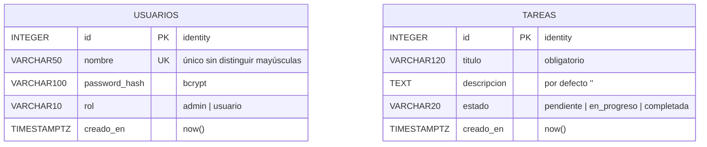

# Diseño de la base de datos — Sistema de gestión de tareas

**Motor:** PostgreSQL 14+ (probado en 16). **Base:** `tareas`. **Tablas:** 2. **Relaciones:** ninguna, a propósito.

## Diagrama entidad-relación



## Decisiones de diseño

| Decisión | Por qué |
|----------|---------|
| Solo 2 tablas, sin relación entre ellas | El parcial evalúa patrones, no el modelo de datos. Ningún caso de uso necesita saber quién creó una tarea. |
| `GENERATED ALWAYS AS IDENTITY` | Es la forma estándar actual de PostgreSQL para claves autoincrementales (reemplaza a `SERIAL`). |
| `rol` y `estado` como `VARCHAR` con `CHECK` | Solo hay valores fijos y pocos. Más simple que un `ENUM` o una tabla extra, y la BD rechaza valores inválidos. |
| Índice único sobre `lower(nombre)` | `Admin` y `admin` son el mismo usuario. |
| Columnas de `tareas` = columnas del CSV | `AdapterTareasCSV` hace un mapeo directo registro → tarea → `INSERT`. |
| `password_hash` bcrypt | Nunca se guardan contraseñas en texto plano. Se genera con `password_hash()` y se valida con `password_verify()` de PHP. |
| `TIMESTAMPTZ DEFAULT now()` | Fecha con zona horaria, permite ordenar la lista sin calcularla en el código. |
| Scripts idempotentes | `IF NOT EXISTS` y `ON CONFLICT DO NOTHING` permiten re-ejecutarlos sin error ni duplicados. |

## Defensa en dos capas
La validación del CSV ocurre en `AdapterTareasCSV` (omite filas inválidas y las informa). Los `CHECK` de la BD son la última barrera: si algo se escapa, PostgreSQL lo rechaza.

## Puesta en marcha

1. Crear la base en el servidor PostgreSQL externo (`CREATE DATABASE tareas;`).
2. Ejecutar `esquema.sql` y luego `seed.sql` en el editor SQL del servidor (o con `psql -f`).
3. Completar los datos de conexión (host, puerto, base, usuario, clave, `sslmode`) al inicio de `conexion.php`.

## Consultas que usa la aplicación (PDO, parámetros `?`)

```sql
-- Login (index.php)
SELECT nombre, password_hash, rol FROM usuarios WHERE lower(nombre) = lower(?);

-- TareaReal::listarTareas()
SELECT id, titulo, descripcion, estado FROM tareas ORDER BY creado_en, id;

-- TareaReal::crearTarea()  (también se usa al importar el CSV)
INSERT INTO tareas (titulo, descripcion, estado) VALUES (?, ?, ?) RETURNING id;

-- TareaReal::eliminarTarea()  (solo se llega aquí si ProxyTarea lo permite)
DELETE FROM tareas WHERE id = ?;   -- si rowCount() = 0 → 404
-- y si la tabla quedó vacía, la numeración vuelve a empezar en 1:
ALTER TABLE tareas ALTER COLUMN id RESTART WITH 1;
```

**Numeración en pantalla:** PostgreSQL nunca reutiliza un id borrado, así que los ids reales pueden tener saltos (1, 2, 3, 10…). Por eso la columna `#` de la vista muestra la **posición** en la lista (1, 2, 3…), siempre consecutiva, y el id real viaja oculto en el formulario de eliminar. Cuando se borra la última tarea, `TareaReal` reinicia la secuencia y la próxima tarea vuelve a tener id 1.

```sql
```

La importación guarda cada fila válida con `crearTarea()`; las filas inválidas ya fueron descartadas por `AdapterTareasCSV` antes de llegar a la base.

## Archivos
- `esquema.sql` — crea las tablas y el índice.
- `seed.sql` — usuarios `admin/admin123` y `usuario/usuario123`, más 3 tareas.
- `conexion.php` — datos de conexión y función `crearConexion()`.
- `adapter/tareas-ejemplo.csv` — 3 filas válidas y 1 inválida para la demo del Adapter.

## Verificación realizada
En PostgreSQL 16: esquema y seed ejecutados dos veces seguidas, 2 usuarios y 3 tareas, sin duplicados. La BD rechazó un estado inválido, un título vacío y el usuario duplicado `Admin`. `DELETE` de un id inexistente devuelve 0 filas afectadas.
