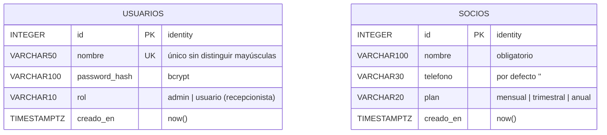

# Diseño de la base de datos: gestión de socios del gimnasio

**Motor:** PostgreSQL 18 (local, puerto 5433). **Base:** `DBArqui`. **Tablas:** 2. **Relaciones:** ninguna, a propósito.

Esta base es la **capa de datos** del sistema. Solo acceden a ella las clases de la carpeta `datos/` (`DSocio`, `DUsuario`, con el PDO que entrega `Conexion`).

## Diagrama entidad-relación



## Decisiones de diseño

| Decisión | Por qué |
|----------|---------|
| Solo 2 tablas, sin relación entre ellas | El parcial evalúa patrones, no el modelo de datos. Ningún caso de uso necesita saber quién registró a un socio. |
| `GENERATED ALWAYS AS IDENTITY` | Es la forma estándar actual de PostgreSQL para claves autoincrementales. |
| `rol` y `plan` como `VARCHAR` con `CHECK` | Son pocos valores fijos. Es más simple que un `ENUM` o una tabla extra, y la BD rechaza los valores inválidos. |
| Índice único sobre `lower(nombre)` | `Admin` y `admin` son el mismo usuario. |
| Columnas de `socios` = columnas del CSV | `AdapterSociosCSV` mapea directo: registro → socio → `INSERT`. |
| `password_hash` bcrypt | Nunca se guardan contraseñas en texto plano. |
| Scripts idempotentes | Con `IF NOT EXISTS` y `ON CONFLICT DO NOTHING` se pueden volver a ejecutar sin errores ni duplicados. |

## Validación en dos niveles
`AdapterSociosCSV` (negocio) valida cada fila del CSV, omite las inválidas e informa el motivo. `Socio` (negocio) vuelve a validar cada alta. Los `CHECK` de la BD son la última barrera: si algo se escapa, PostgreSQL lo rechaza.

## Consultas que usa la aplicación (PDO, parámetros `?`)

```sql
-- DUsuario::buscarPorNombre()  (login)
SELECT nombre, password_hash, rol FROM usuarios WHERE lower(nombre) = lower(?);

-- DSocio::listar()
SELECT id, nombre, telefono, plan FROM socios ORDER BY creado_en, id;

-- DSocio::registrar()  (también se usa al importar el CSV)
INSERT INTO socios (nombre, telefono, plan) VALUES (?, ?, ?) RETURNING id;

-- DSocio::eliminar()  (solo se llega aquí si ProxySocio lo permite)
DELETE FROM socios WHERE id = ?;   -- si rowCount() = 0 devuelve false y Socio responde 404
-- si la tabla quedó vacía, la numeración vuelve a empezar en 1:
ALTER TABLE socios ALTER COLUMN id RESTART WITH 1;
```

**Numeración en pantalla:** la columna `#` muestra la **posición** en la lista (1, 2, 3…), no el id real, porque los ids pueden tener saltos. El id real viaja oculto en el formulario de baja.

## Archivos
- `esquema.sql`: crea las tablas y el índice.
- `seed.sql`: usuarios `admin/admin123` y `usuario/usuario123`, más 3 socios.
- `datos/Conexion.php`: datos de conexión y el método `conectar()`.
- `datos/socios-ejemplo.csv`: 3 filas válidas y 1 inválida para la demo del Adapter.
