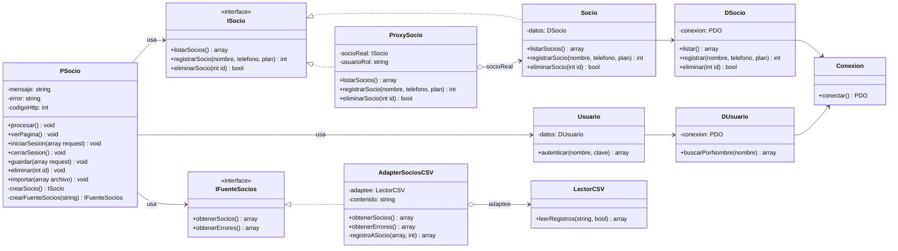

# Gimnasio: gestión de socios (parcial de Patrones de Diseño)

Sistema web en **3 capas** (presentación, negocio, datos) hecho en **PHP puro** + **PostgreSQL**. Demuestra dos patrones GoF estructurales.

| Caso de uso | Patrón | Clases |
|-------------|--------|--------|
| CU1: Dar de baja a un socio (solo administradores) | **Proxy** de protección | `ISocio`, `Socio`, `ProxySocio` |
| CU2: Importar socios desde un archivo CSV | **Adapter** | `IFuenteSocios`, `AdapterSociosCSV`, `LectorCSV` |

## Problemática

El gimnasio usa un sistema web en 3 capas. Hay dos tipos de personal: el **administrador** y el **recepcionista** (rol `usuario`). Los dos pueden ver la lista de socios y registrar socios nuevos.

**CU1: Proxy.** Dar de baja a un socio es una operación destructiva e irreversible: se pierde su registro. Por eso solo puede hacerlo el administrador. `Socio` ya aplica las reglas del socio y delega el SQL en `DSocio`. No conviene mezclarle reglas de permisos: cada cambio de permisos obligaría a tocar una clase que ya funciona, con el riesgo de romperla. Tampoco basta con ocultar el botón en la vista, porque cualquiera puede enviar la petición directamente.
**Solución:** `ProxySocio` implementa la misma `ISocio` que `Socio`. La presentación (`PSocio`) solo conoce la interfaz. El proxy deja pasar `listarSocios()` y `registrarSocio()`. En `eliminarSocio()` verifica que el rol sea `admin` antes de delegar: si no lo es, responde 403 y `Socio` nunca se ejecuta.

**CU2: Adapter.** Al abrir el sistema, el gimnasio quiere cargar a los socios que ya tenía anotados en una planilla de recepción, exportada como CSV. El componente de la capa de datos que lee archivos (`LectorCSV`) solo entrega **filas de texto por posición** (`string[][]`) mediante `leerRegistros(contenido, tieneEncabezado)`, por ejemplo `["Ana Pérez", "70012345", "mensual"]`: sin nombres de campo, sin validar y sin valores por defecto. La capa de negocio, en cambio, espera `IFuenteSocios::obtenerSocios()`, que devuelve `['nombre' => ..., 'telefono' => ..., 'plan' => ...]` con el nombre obligatorio y un plan permitido. Las dos son **interfaces incompatibles**. No queremos que el negocio dependa del formato CSV, ni modificar el lector, que solo sabe separar líneas y columnas.
**Solución:** `AdapterSociosCSV` implementa `IFuenteSocios` (Target) y por dentro usa `LectorCSV` (Adaptee). Con `registroASocio()` convierte cada fila en un socio: recorta los espacios, aplica el plan por defecto (`mensual`) y omite las filas inválidas informando el motivo. Si mañana los socios llegan desde otro formato (JSON, Excel o el torniquete de acceso), se crea otro adapter y el resto del sistema no cambia.

| Diagrama genérico | Este sistema |
|-------------------|--------------|
| `Client` | `PSocio` |
| `Target` / `Request()` | `IFuenteSocios` / `obtenerSocios()` |
| `Adapter` / `Request()` | `AdapterSociosCSV` / `obtenerSocios()` |
| `Adaptee` / `SpecificRequest()` | `LectorCSV` / `leerRegistros()` |

## Las 3 capas

Se sigue la misma convención del ejemplo de eventos (`PEvento` → `IEvento`/`Evento` → `DEvento` → `Conexion`): una clase por capa con prefijo y color.

| Capa | Color en el diagrama | Carpeta | Clases |
|------|----------------------|---------|--------|
| Presentación | verde | [presentacion/](presentacion/) | `PSocio` (+ plantilla `vista.php`) |
| Negocio | azul | [negocio/](negocio/) | `ISocio`, `Socio`, `ProxySocio`, `IFuenteSocios`, `AdapterSociosCSV`, `Usuario` |
| Datos | amarillo | [datos/](datos/) | `DSocio`, `DUsuario`, `Conexion`, `LectorCSV` |

La cadena es `PSocio → ISocio (ProxySocio → Socio) → DSocio → Conexion`. Cada capa llama solo a la de abajo. La presentación no escribe SQL y la capa de datos no conoce ni las reglas ni los permisos.

## Diseño



En Enterprise Architect, [diagrama-ea.js](diagrama-ea.js) genera 3 diagramas con colores por capa: **General** (todo el sistema), **CU1 Proxy** y **CU2 Adapter** (solo las clases de cada caso de uso).

Diagramas exportados: [CU1 Proxy](Diseño%20Procedimental%20-%20CU1%20Proxy.png) · [CU2 Adapter](Diseño%20Procedimental%20-%20CU2%20Adapter.png).

## Estructura

```
index.php        Punto de entrada: carga las 3 capas y llama a (new PSocio())->procesar()
presentacion/    PSocio · vista.php (plantilla HTML)
negocio/         ISocio · Socio · ProxySocio · IFuenteSocios · AdapterSociosCSV · Usuario
                 ProxyTest · AdapterTest
datos/           Conexion · DSocio · DUsuario · LectorCSV · socios-ejemplo.csv
esquema.sql, seed.sql
```

## Uso

Requisitos: PHP 8.1+ con `pdo_pgsql` y `mbstring`, y la base `DBArqui` con las tablas `usuarios` y `socios` (el diseño está en [DISENO-BD.md](DISENO-BD.md)). Los datos de conexión están en `datos/Conexion.php` (PostgreSQL local en el puerto **5433**). **Antes de ejecutarlo, escribe la contraseña de tu PostgreSQL en la constante `CLAVE`**; en el repositorio aparece como `tu_clave`. Si falta la tabla `socios`, ejecuta `esquema.sql` y `seed.sql`; los dos scripts son idempotentes.

```bash
php negocio/ProxyTest.php     # 5 pruebas del Proxy (no usan la base)
php negocio/AdapterTest.php   # 6 pruebas del Adapter (no usan la base)
php -S localhost:3000         # abrir http://localhost:3000
```

| Usuario | Contraseña | Rol |
|---------|------------|-----|
| `admin` | `admin123` | admin: puede dar de baja socios |
| `usuario` | `usuario123` | recepcionista: recibe 403 al dar de baja |

Para la demo del Adapter, importa [datos/socios-ejemplo.csv](datos/socios-ejemplo.csv). Se importan 3 socios y se omite 1 fila (falta el nombre).

## Decisiones

- **Convención P/N/D del ejemplo.** `PSocio` es la presentación, `Socio` es el negocio y `DSocio` son los datos. Las interfaces llevan el prefijo `I`.
- **`Socio` (SujetoReal) está en negocio y delega el SQL en `DSocio`, igual que `Evento` → `DEvento`.** Así la capa de datos no depende del negocio.
- **Las validaciones del socio (nombre obligatorio, plan válido y que el socio exista) están en `Socio`.** El permiso para dar de baja está en `ProxySocio`.
- **`PSocio` es el único lugar que construye los objetos** (`new ProxySocio(new Socio(new DSocio(new Conexion())), $rol)`). El HTML está separado en `vista.php`.
- **`Conexion` no es Singleton:** `conectar()` abre un PDO nuevo cada vez.
- **El rol `usuario` de la tabla existente representa al recepcionista.** La tabla `tareas` de la versión anterior se dejó en la base sin usar.
