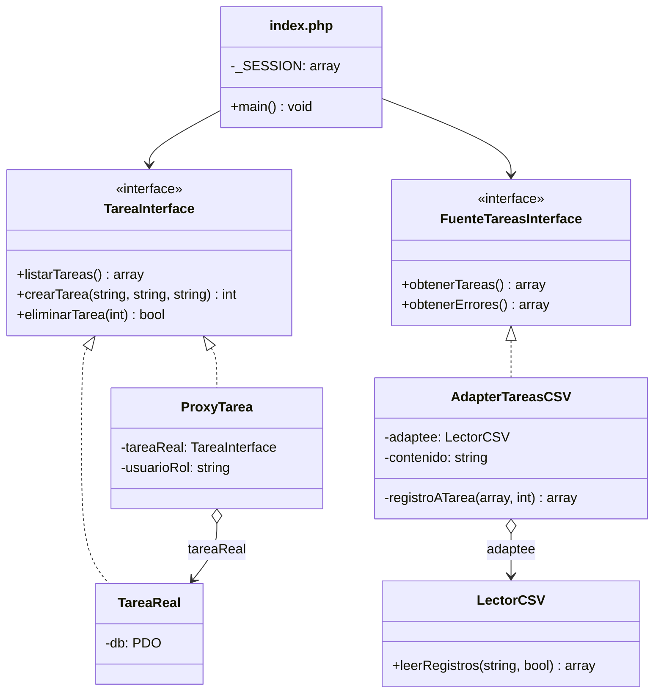

# Gestión de tareas — Parcial de Patrones de Diseño

Sistema web en **PHP puro** + **PostgreSQL** que demuestra dos patrones GoF estructurales.

| Caso de uso | Patrón | Carpeta |
|-------------|--------|---------|
| CU1 — Eliminar tarea (solo administradores) | **Proxy** de protección | [proxy/](proxy/) |
| CU2 — Importar tareas desde un archivo CSV | **Adapter** | [adapter/](adapter/) |

## Problemática

**CU1 — Proxy.** Cualquier usuario autenticado puede listar y crear tareas, pero eliminar es destructivo y solo deben hacerlo los administradores. `TareaReal` ya resuelve el acceso a PostgreSQL y no conviene mezclarle reglas de seguridad; ocultar el botón en la vista tampoco protege nada. **Solución:** `ProxyTarea` implementa la misma `TareaInterface` que `TareaReal` y verifica el rol antes de delegar `eliminarTarea()`.

**CU2 — Adapter.** El sistema trabaja con tareas validadas (`titulo`, `descripcion`, `estado`), pero las tareas que se quieren cargar vienen en archivos CSV, y el componente que los lee (`LectorCSV`) solo entrega filas de texto por posición (`string[][]`). Son interfaces incompatibles. No queremos que el sistema dependa del formato CSV ni modificar el lector, que solo sabe separar líneas y columnas. **Solución:** `AdapterTareasCSV` implementa `FuenteTareasInterface` y por dentro usa `LectorCSV`, convirtiendo cada fila en una tarea. Si mañana llega otro formato (JSON, Excel), se crea otro adapter y el sistema no cambia.

## Diseño



## Estructura

```
proxy/     TareaInterface · TareaReal · ProxyTarea · ProxyTest
adapter/   FuenteTareasInterface · LectorCSV · AdapterTareasCSV · AdapterTest · tareas-ejemplo.csv
index.php      main(): acciones + vistas (login y tareas). Cliente de los dos patrones
conexion.php   datos de la base + crearConexion()
```

## Uso

Requisitos: PHP 8.1+ con `pdo_pgsql` y la base `DBArqui` con las tablas `usuarios` y `tareas` (diseño en [DISENO-BD.md](DISENO-BD.md)). Los datos de conexión están en `conexion.php` (PostgreSQL local en el puerto **5433**). **Antes de ejecutar, escribe la contraseña de tu PostgreSQL en `BD_CLAVE`** (en el repositorio va como `tu_clave`). Si la base está vacía, crea las tablas y los datos de prueba ejecutando `esquema.sql` y `seed.sql`.

El diseño UML está en `archi/diagramapro.eapx` (Enterprise Architect) y como imagen en `Diseño Procedimental.png`.

```bash
php proxy/ProxyTest.php       # 5 pruebas del Proxy (no usan la base)
php adapter/AdapterTest.php   # 6 pruebas del Adapter (no usan la base)
php -S localhost:3000         # abrir http://localhost:3000
```

| Usuario | Contraseña | Rol |
|---------|------------|-----|
| `admin` | `admin123` | admin (puede eliminar) |
| `usuario` | `usuario123` | usuario (recibe 403 al eliminar) |

Para la demo del Adapter, importar [adapter/tareas-ejemplo.csv](adapter/tareas-ejemplo.csv): importa 3 tareas y omite 1 fila (falta el título).

## Decisiones

- Solo dos carpetas (`proxy/`, `adapter/`) y dos `.php` fuera: `index.php` y `conexion.php`.
- Nombres de dominio con el rol visible (`*Interface`, `*Real`, `Proxy*`, `Adapter*`). El Adaptee se llama `LectorCSV`: no es un componente antiguo, sino una clase existente cuya interfaz (filas de texto) no coincide con la que espera el sistema.
- `ProxyTarea` recibe el objeto real por constructor (`new ProxyTarea(new TareaReal($db), $rol)`), para poder probarlo con un espía sin base de datos.
- Errores con `DomainException` y código HTTP (403 / 404). La conexión no es Singleton: `crearConexion()` devuelve un PDO nuevo.
